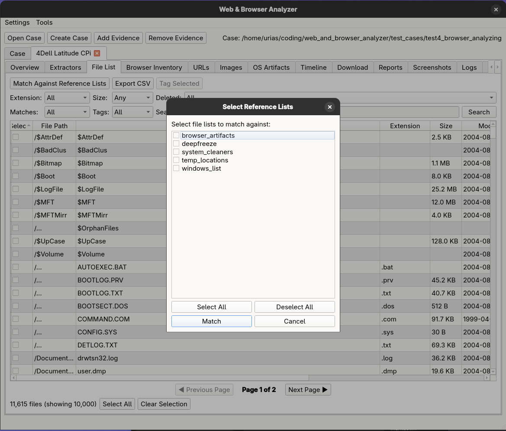

# File List (Tab)

File List Tab - UI for viewing and managing file list entries.

## Purpose
- Review file system entries extracted from evidence.
- Filter, tag, and match files against reference lists.

## When to use
- When you need to triage large file inventories by type, size, or path.
- When you want to tag or match files against known lists.

## Data sources
- Evidence database file_list table plus tag and match tables.

## Key controls
- Filters: extension, size, deleted status, matches, tags, search and exclude. All filters combine.
- **Search** shows files whose name or path contains the text. **Exclude** hides files whose name or path contains the text, for example `WinSxS`. Both are literal: ASCII letter case is ignored, and `%`, `_` and `\` match as themselves (not as wildcards). Leading and trailing spaces are ignored. Both apply when you press Enter or **Search**; changing a dropdown also applies them. Search `.dll` with Exclude `WinSxS` shows DLLs outside `WinSxS`.
- **Tags** dropdown: **All**, **Any Tag** (files with at least one tag), **Untagged** (files whose Tags cell is empty), then the tag names. Any Tag and Untagged together cover all files. A tag that is itself named `Untagged` or `any` is listed separately and filters as a normal tag.
- The dropdowns keep their selection when their lists reload (after tagging or matching). While a list is loading or failed to load, the selected filter stays applied.
- Actions: Match Against Reference Lists, Export CSV, Tag Selected.
- Pagination controls for large datasets.

## Outputs
- CSV export of the current filtered file list (the loaded rows).
- Tag and match results stored in the case database.

## Subtabs
- None

## Notes
- Matching runs in the background; large lists may take time to process.
- Lists can be uploaded over settings - see the docs
